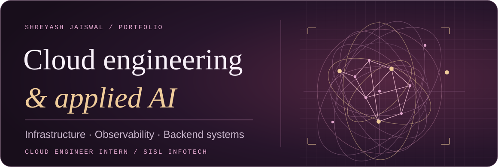
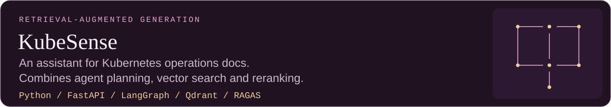
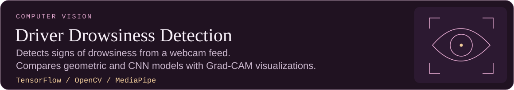
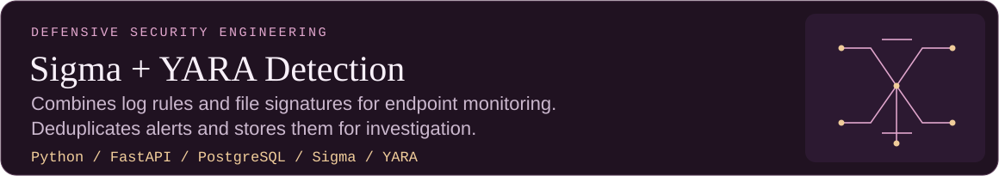

  
  
  
  

## About

I’m a Cloud Engineer Intern at SISL Infotech and an MCA student in AI/ML at VIT Vellore. I work across cloud infrastructure, networking, monitoring, and operational support on Google Cloud and AWS. My earlier work spans defensive backend services, retrieval systems, and explainable machine learning.

**Career focus** · Cloud engineering, DevOps, cloud infrastructure, and site reliability engineering (SRE)

## Current internship

**Cloud Engineer Intern · SISL Infotech Pvt. Ltd.**  
November 2026–present · New Delhi, India · On-site

- **Compute and networking.** Deploy and manage virtual machines with GCP Compute Engine and AWS EC2. Configure custom VPCs, public and private subnets, firewall rules, routes, VPC Peering, and Shared VPC across GCP projects.
- **AWS architecture and infrastructure security.** Built a private EC2 environment using an Application Load Balancer, NAT Gateway, Internet Gateway, Elastic IP, and security groups. Practice network isolation, private VM connectivity, and controlled ingress and egress.
- **Monitoring and alerting.** Use Google Cloud Monitoring, Cloud Logging, Logs Explorer, log-based alerts, and Ops Agent. Explore monitoring workflows with Azure Monitor, Grafana, and Prometheus.
- **Identity and automation.** Work with GCP IAM roles and permissions and use Bash to export IAM information to CSV for review.
- **Cloud operations.** Support the First Response Team (FRT) by reviewing CPU, memory, disk, and website availability alerts and helping with incident communication and escalation.
- **Continuous learning.** Build hands-on experience in cloud architecture, Linux, networking, troubleshooting, automation, and DevOps.

## Earlier experience and education

- **Artificial Intelligence Intern · Allatone Solutions Pvt. Ltd.** · July–October 2026 · New Delhi, hybrid. Built FastAPI and PostgreSQL services for Sentinel, an endpoint detection and response platform, including a [communication channels API](https://github.com/yashjais1/Communication-Channel-API-FastAPI-PostgreSQL-with-CRUD-endpoints) with validation for email and phone records. Also worked on learning analytics and AI agents.
- **Data Analyst Intern · Unified Mentor Private Limited** · August–September 2024 · Hybrid. Used Python, SQL, and Power BI for data cleaning, exploratory analysis, and reporting dashboards.
- **MCA in AI/ML · Vellore Institute of Technology.** Research on multimodal machine learning and explainability.
- **BCA · Shri Ram Swaroop Memorial University** · August 2022–July 2025.

## Selected work

[View KubeSense repository](https://github.com/yashjais1/KubeSense-Agentic-RAG-assistant-for-Kubernetes-operations-docs)

[View CMAFusion-XAI repository](https://github.com/yashjais1/CMAFusion_XAI)

[View Driver Drowsiness Detection repository](https://github.com/yashjais1/Driver-Drowsiness-Detection-System)

[View Sigma + YARA Detection repository](https://github.com/yashjais1/sigma-yara-detection-pipeline)

[View Campus Lost & Found repository](https://github.com/yashjais1/lost-and-found-campus-portal-Redis-BullMQ-Integration)

## Toolkit

**Cloud stack** · GCP, AWS, Compute Engine, EC2, VPC, IAM, load balancing, NAT Gateway, Cloud Monitoring, Cloud Logging, Azure Monitor, Grafana, Prometheus, Linux, Bash, and networking.

## Commit log

[View live contributions on GitHub](https://github.com/yashjais1#js-contribution-activity)

## Certifications and badges

- **Microsoft** · [Microsoft Certified: SQL AI Developer Associate](https://learn.microsoft.com/api/credentials/share/en-in/Shreyashjaiswal-7209/E16CEED6664201B3?sharingId=37D15F8B04E507DD)
- **Microsoft Learn** · [Implement SQL solutions by using AI-assisted tools](https://learn.microsoft.com/api/achievements/share/en-in/Shreyashjaiswal-7209/H249KYT8?sharingId=37D15F8B04E507DD) · [Write advanced T-SQL code](https://learn.microsoft.com/api/achievements/share/en-in/Shreyashjaiswal-7209/QL39VAZE?sharingId=37D15F8B04E507DD) · [Design and implement database objects with SQL](https://learn.microsoft.com/api/achievements/share/en-in/Shreyashjaiswal-7209/NQDK9HRF?sharingId=37D15F8B04E507DD)
- **IBM SkillsBuild** · [AI Literacy](https://www.credly.com/badges/49e51f9b-bcb6-47ab-8494-c5ffe2b61f5d)
- **CITI Program** · Data or Specimens Only Research
- **Google via Coursera** · Crash Course on Python

## Connect

  
  
  
  

