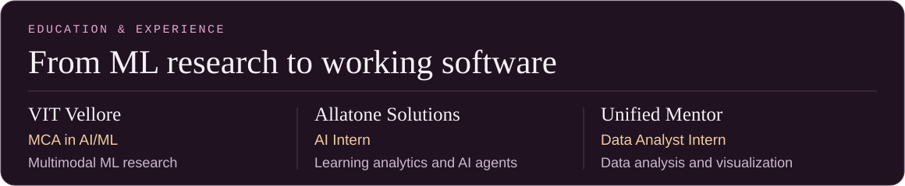
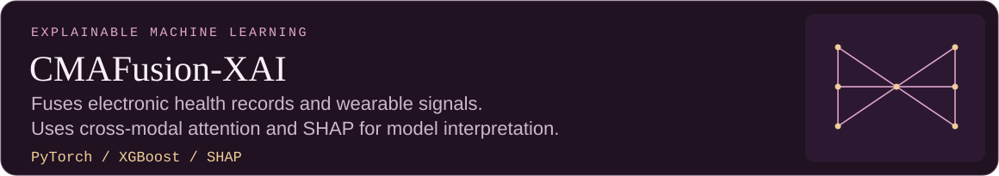
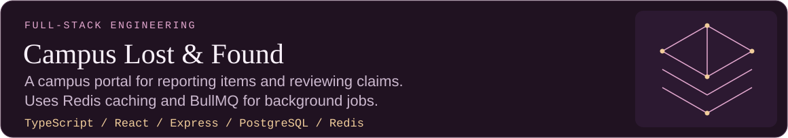
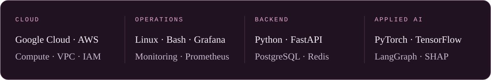

  
  
  

## About

I build retrieval systems for technical documentation, study how multimodal models make predictions, and develop the backend services that make those systems usable.

### Current internship

**Artificial Intelligence Intern · Allatone Solutions Pvt. Ltd.**  
July 2025–present · New Delhi

I build FastAPI and PostgreSQL services for Sentinel, an endpoint detection and response platform. My work includes a [communication channels API](https://github.com/yashjais1/Communication-Channel-API-FastAPI-PostgreSQL-with-CRUD-endpoints) with typed validation for email and phone records, as well as work on learning analytics and AI agents.

## Selected work

[View KubeSense repository](https://github.com/yashjais1/KubeSense-Agentic-RAG-assistant-for-Kubernetes-operations-docs)

[View CMAFusion-XAI repository](https://github.com/yashjais1/CMAFusion_XAI)

[View Driver Drowsiness Detection repository](https://github.com/yashjais1/Driver-Drowsiness-Detection-System)

[View Sigma + YARA Detection repository](https://github.com/yashjais1/sigma-yara-detection-pipeline)

[View Campus Lost & Found repository](https://github.com/yashjais1/lost-and-found-campus-portal-Redis-BullMQ-Integration)

## Toolkit

## Commit log

[View live contributions on GitHub](https://github.com/yashjais1#js-contribution-activity)

## Certifications

- **IBM SkillsBuild** · AI Literacy
- **CITI Program** · Data or Specimens Only Research
- **Google via Coursera** · Crash Course on Python

## Connect

  
  
  

